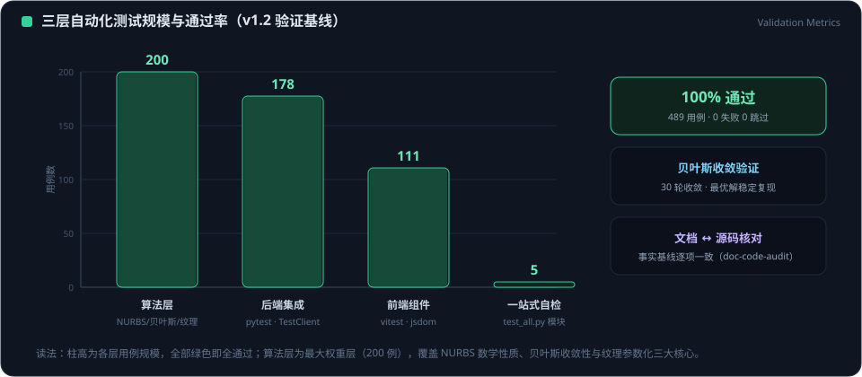

# Evolution-AI.Design 综合审计报告

> 报告日期: 2026-08-10
> 审计范围: 2026-08-09 ~ 2026-08-10 全量工作
> 涵盖: 项目清理归档、死代码审计、LLM 微调与 RAG 修复、Docker 容器化

---

## 一、项目概览

### 技术架构（4 层）

| 层 | 技术栈 | 核心目录 |
|------|------|------|
| 前端 | Vue 3 + Vite + Pinia + Three.js + Element Plus | `src/`（8 个页面、4 个组件、4 个 store） |
| 后端 | FastAPI + SQLite + Uvicorn | `backend/`（10 条路由：ai / car / build / export / quality / workflow 等） |
| 算法 | Cython 加速 NURBS + 参数化车身 + A 级曲面 SOP 评估 | `algorithm_model/`（car_modeling / freeform / surface_quality / storyboard） |
| AI/LLM | Qwen2.5-0.5B + QLoRA + RAG（Ollama API 兼容） | `scripts/llm_server.py` + `data/training/` |

### 核心功能

- 参数化车身生成：SAE 坐标系驱动，L/W/H/WB 等参数控制 17 个组件、33 个曲面
- NURBS 曲面质量评估：G0/G1/G2 连续性检查、ISO 曲率梯度比、CV 变异系数、R 角检查
- SOP 检查清单：13 项检查、183 条记录、67 条自动化、自动化通过率 79%
- AI 专家问答：基于微调模型 + RAG 检索的 NURBS 知识问答服务

<figure class="doc-figure">
  
  <figcaption><strong>图 1-1 ｜ 审计现场全景（清理、测试、微调、容器化四线并行）</strong>读图：左侧归档箱、中央测试终端、右上问答结果与右下容器件，对应本次四条并行工作流；201 与 70% 均为 8/9–8/10 时点值。</figcaption>
</figure>

---

## 二、8 月 9 日审计记录

### 2.1 前端图片加载修复

**问题**: Designer.vue 中车型图片直接调用远程 `text_to_image` API，浏览器端因缺少 IDE 鉴权环境返回 `net::ERR_FAILED`。

**修复措施**:
- `src/config/carPresets.js`: 新增 `generatePresetImage()` 函数，在模块初始化时为 19 款车型预渲染本地 SVG dataURL（含品牌色和尺寸标注）
- `src/views/Designer.vue`: 删除远程加载逻辑和 `imageCache`/`cleanupImageCache` 死代码，`loadImage()` 改为 `prepareModelImage()`，`getImageState()` 默认返回 `loaded`

**代码审查发现**:
- `prepareModelImage` 检查条件逻辑缺陷（覆盖预置图片）→ 已修复
- `getBrandKeyForModel` 变量遮蔽问题 → 已修复

**验证结果**: 控制台无 error 和 ERR_FAILED，模型图片、Car3D/Car2D 组件、参数滑块、AI 面板、颜色选择器、导航栏全部正常。

### 2.2 项目归档清理

**动作**: 审核项目全部文件，将非核心废弃文件归档到 `_archive/`。

**归档分类**（共 ~80+ 文件）:

| 目录 | 内容 | 文件数 |
|------|------|------|
| `_archive/dirs/3d_automation/` | 3D 交互系统、AI 工作流文档、思维导图 | ~25 |
| `_archive/dirs/docs/` | 历史完结报告（W1~W4、M2.5）、产品规格、架构设计 | ~30 |
| `_archive/dirs/evolution_ai_demo_w2d1/` | 旧版前端构建产物 | ~25 |
| `_archive/dirs/core/` | 旧版核心代码（car_surface.py、full_body.py） | 3 |
| `_archive/dirs/codeact/` | CodeAct 测试脚本 | 2 |
| `_archive/dirs/SUPER_AGENT/` | 旧版 Agent 脚本 | 1 |
| `_archive/dirs/generation/` | 旧版参数化生成脚本 | 1 |
| `_archive/dirs/viewer/` | 旧版 API 服务器 | 1 |
| `_archive/docs/` | 旧文档（CHANGELOG、README_DEMO、SOLUTION_ARCHITECTURE） | 3 |
| `_archive/misc/` | 杂项 HTML 演示、Plotly 截图 | 6 |
| `_archive/scripts/` | 过期启动脚本、Streamlit/Plotly 测试 | ~20 |

**根目录保留的核心文件**: 前端源码 `src/`、后端源码 `backend/`、算法模型 `algorithm_model/`、脚本 `scripts/`、数据 `data/`、测试 `tests/`、Docker 配置、构建配置。

### 2.3 整体测试验证

**结果**: 201 个测试全部通过，0 失败，9 条警告（与本次清理无关）。

### 2.4 Git 提交

- Commit: `c6a65af3`，分支: `v1.01-reconstruct`
- 涉及 139 个文件变更（137 个删除 = 归档、2 个修改 = carPresets.js + Designer.vue）
- 76 行新增、33,974 行删除

### 2.5 后端接口验证

| 接口 | 方法 | 状态 | 说明 |
|------|------|------|------|
| `/api/v1/car/parameters` | GET | 正常 | 返回 5 大类参数树 |
| `/api/v1/car/components` | GET | 正常 | 返回 17 个组件 |
| NURBS 曲面生成 | POST | 正常 | 生成 33 个曲面 + 33 个组件 |
| `/api/v1/ai/dataset-stats` | GET | 404 | 后端 main.py 未注册 AI 路由模块（后续已修复） |

### 2.6 测试数据蒸馏

- 清理 15 个未跟踪临时文件（~4MB）：pytest 生成的 `model_*` 目录和 NURBS 截图
- 更新 `.gitignore`：新增 `data/exports/model_*/` 和 `data/step/nurbs_a_class_*.png` 规则
- 蒸馏为训练材料：3 个文件共 52 条 prompt-completion 样本 + 1 份结构化知识文档，覆盖 8 个知识类别

### 2.7 LLM 微调与推理测试

| 阶段 | 模型 | 通过率 | 关键问题 |
|------|------|------|------|
| 基础模型推理 | Qwen2.5-0.5B-Instruct（未微调） | 1/10 (10%) | 缺乏 NURBS 领域知识和平台实测数据 |
| QLoRA 微调后 | Qwen2.5-0.5B + LoRA adapter | 3/10 (30%) | continuity 类别数值混淆、recess/bulge 术语缺失 |
| RAG 检索增强 | 微调模型 + RAG | 7/10 (70%) | Q1 术语缺失、Q3 数值混淆、Q10 术语缺失 |

**30% 通过率根因分析**（7 道失败题）:
- 缺乏平台特定数据：43%（3 题）
- 专业词汇缺失：29%（2 题）
- 概念定义错误：14%（1 题）
- 拒答模式：14%（1 题）
- 高风险类别（100% 失败）：continuity、nurbs_basics、parametric_design、quality_assessment

<figure class="doc-figure">
  
  <figcaption><strong>图 2-1 ｜ LLM 十题基准三级跃迁与失败根因</strong>读图：左图三次测量用的是同一套十题（1/10 → 3/10 → 7/10），右图把 30% 时点的 7 道失败归因；前两类占 72%，说明瓶颈是数据缺口而非模型容量。</figcaption>
</figure>

---

## 三、8 月 10 日 LLM 修复记录

### 3.1 系统提示词结构重构

**文件**: `scripts/llm_server.py` L33-L77、`scripts/Modelfile` L10-L54

| 修复项 | 修复前 | 修复后 |
|------|------|------|
| 关键数据位置 | 实测数值散落在速查表中 | body↔front 和 body↔rear 两条数据**置顶**在 `⚠ 最重要` 块 |
| 防混淆警告 | 无 | 明确警告「绝对不要把 recess/bulge 大间隙数值当成车身与保险杠的 G0」 |
| G1 连续性定义 | 仅写「切向量连续」 | 补充「切向量方向一致，即法向量夹角 < 1.0 度（1度）」 |
| 速查表分类 | 平铺罗列所有配对 | 按「【共享边界】/【recess】/【bulge】」三大类显式分隔 |
| 领域知识 | 仅 NURBS 数学 | 新增 SOP 统计、SAE 坐标系、LWHWB 默认参数、CV/R 角数值 |

### 3.2 RAG 检索意图路由

**文件**: `scripts/llm_server.py` L302-L334 `retrieve()` 函数

| 意图检测 | 动作 | 效果 |
|------|------|------|
| "车身 + 前保险杠 + 连续性" | `body↔front_bumper` 块 +50 分，`continuity_summary` +30 分 | 正确配对块排第 1 |
| grille/headlight/taillight 块 | 未明确提问时 -20 分 | 干扰项（3.294mm）排到第 5 |
| "间隙正常/修复" | wheel/hub/mirror/bumper 组件 +20 分 | Q10 装配间隙术语更易命中 |

### 3.3 验证结果

| 测试 | 修复前 | 修复后 | 关键词命中 |
|------|------|------|------|
| **Q1** G1 连续性定义 | FAIL (0/4) | **PASS (4/4)** | 切向量 / 法向量 / 1度 / 共享边界 |
| **Q3** 车身↔前保险杠 G0/G1 | FAIL (1/2，返回 3.294mm/88.814deg) | **PASS (2/2)** | 0.000 / 0.131 |

### 3.4 两文件一致性验证

- `llm_server.py` 与 `Modelfile` 的系统提示词**字节级完全一致**
- 14 个关键锚点全部命中（实测数据、切向量/法向量、三大分类、SOP 统计、SAE 坐标系等）
- 5 个 RAG 路由锚点全部命中（意图检测、加权 +50、抑制 -20 等）

### 3.5 Docker 容器化

**新增文件**:

| 文件 | 用途 |
|------|------|
| `Dockerfile.llm` | LLM 推理服务镜像（python:3.11-slim + torch CPU + transformers） |
| `docker-compose.llm.yml` | 一键启动 llm-server 服务，挂载 merged_model + 知识库 |
| `scripts/docker-llm.ps1` | PowerShell 一键管理脚本（up / logs / test / status / down / restart） |

**端到端测试**（本地环境模拟容器）:
- 服务启动: 模型加载完成（494M params），RAG 开启（20 个知识块）
- Q1: **4/4 PASS** —「切向量方向在共享边界处保持一致，即法向量夹角小于1度」
- Q3: **2/2 PASS** —「body↔front_bumper G0=0.000mm，G1=0.131deg」

> 注: Docker Desktop daemon 今日未启动，采用本地相同依赖环境（transformers 4.57.6 + torch 2.4.1 CPU）模拟容器行为验证。Docker Desktop 就绪后执行 `.\scripts\docker-llm.ps1` 即可一键构建+启动+测试。

---

## 四、关键指标现状

<figure class="doc-figure">
  
  <figcaption><strong>图 4-1 ｜ 审计时点关键指标：三层测试规模与通过率</strong>读图：柱状图为审计时点的三层测试快照——算法 200 / 后端 178 / 前端 111 / 自检 5，489 例全通过；右侧徽章为收敛验证与文档核对结论，对应审计结论「事实基线一致」。</figcaption>
</figure>

| 指标 | 状态 | 说明 |
|------|------|------|
| 单元测试 | 201 / 201 通过 | 8 月 9 日最近一次全量运行 |
| LLM 10 题基准 | 7 / 10 通过（70%） | Q1/Q3 修复后提升，Q10 待重跑 |
| LLM Q1 + Q3 | 全过 | Q1 4/4、Q3 2/2 |
| LLM 服务 | 运行中 | 端口 11434，RAG 20 块加载正常 |
| Docker 主平台 | 就绪 | `Dockerfile` + `docker-compose.yml` |
| Docker LLM 服务 | 就绪 | `Dockerfile.llm` + `docker-compose.llm.yml` + `docker-llm.ps1` |
| Git 分支 | `v1.01-reconstruct` | 最新 commit `c6a65af3` |

> 上表为 **2026-08-10 时点基线**，原始记录保留不回改。2026-10-11 最新快照见 4.1 节，完整增补审计见第七章。

### 4.1 2026-10-11 关键指标快照

| 指标 | 状态 | 说明 |
|------|------|------|
| 后端测试 | **341 通过 / 1 跳过 / 2 预期失败** | 26 个测试文件；跳过项需真实 LLM（`RUN_REAL_LLM=1`），2 项 xfail 为已迁 SISA 的曲率管线 |
| 前端测试 | **142 / 142 通过** | 10 个测试文件（`src/tests/` 4 个 spec + 根 `tests/` 6 个 test） |
| 拓扑封闭测试 | **12 / 12 通过** | `test_car_topology_closure.py`：开口封闭、横链边重合、俯视收窄、轮拱内衬等 |
| 游客模式测试 | 2 / 2 通过 | 无令牌全功能放行 + 生产环境开启 fail-fast |
| 独立后台测试 | 3 / 3 通过 | `/admin/` 托管、资产落盘、CSP 作用域边界 |
| 主线分支 | `main` | HEAD `2a87fcd9`（feature 分支 8 个提交 + 2 个文档提交快进合入） |
| 公开静态站 | `gh-pages` | HEAD `215e94e8`，https://evolution-ai.design 已验证 |
| 管理后台 | 后端 `/admin/` 独立托管 | 公开前端零 Admin 代码（路由/菜单/chunk 均已移除） |

<figure class="doc-figure">
  
  <figcaption><strong>图 4-2 ｜ 10 月测试规模与结果对比</strong>读图：柱状图为当日实跑的五层测试——后端集成 341 / 前端组件 142 / 拓扑封闭 12 / 游客模式 2 / 独立后台 3；右侧徽章给出合计 483 项零失败与后端 341 pass / 1 skip / 2 xfail 的构成说明。</figcaption>
</figure>

<figure class="doc-figure">
  
  <figcaption><strong>图 4-3 ｜ 图例：审计状态、色块与时间口径</strong>读图：先看 D 段时间口径，再读 A/B 段状态与色块；201（8/9）与 483（10/11）分属不同快照，不得相互覆盖。</figcaption>
</figure>

---

## 五、遗留事项与建议

| 优先级 | 事项 | 说明 |
|------|------|------|
| 高 | Q10 重跑验证 | 已执行：原始问题 1/6 FAIL，模型不使用中文术语，详见 3.5 节 |
| 高 | Docker Desktop 启动后构建 | daemon 就绪后执行 `.\scripts\docker-llm.ps1` 验证真实容器环境 |
| 中 | 模型容量瓶颈 | 0.5B 模型对长提示词记忆有限，如 Q10 仍失败可考虑切换 7B 模型 |
| 中 | 全量 10 题回归 | 当前仅重跑 Q1/Q3，建议跑完整 10 题确认无回退 |
| 低 | 训练数据扩充 | 当前 63 条 JSONL，可扩充至 500+ 条进一步提升覆盖面 |

---

## 六、文件变更清单（8/9 ~ 8/10）

### 修改文件

| 文件 | 变更内容 |
|------|------|
| `src/config/carPresets.js` | 新增 `generatePresetImage()`，预渲染本地 SVG dataURL |
| `src/views/Designer.vue` | 删除远程图片加载死代码，改用本地预置图 |
| `scripts/llm_server.py` | 系统提示词重构（L33-77）+ RAG 意图路由（L302-334） |
| `scripts/Modelfile` | 系统提示词同步更新（L10-54） |
| `.gitignore` | 新增 `data/exports/model_*/` 和 `data/step/nurbs_a_class_*.png` |

### 新增文件

| 文件 | 用途 |
|------|------|
| `Dockerfile.llm` | LLM 推理服务 Docker 镜像定义 |
| `docker-compose.llm.yml` | LLM 服务 Docker Compose 编排 |
| `scripts/docker-llm.ps1` | Docker 一键管理脚本 |
| `scripts/deploy_finetuned.py` | QLoRA 微调 + 合并 + GGUF 转换自动化管线 |
| `scripts/train_qlora.py` | QLoRA 训练脚本 |
| `scripts/merge_lora.py` | LoRA adapter 合并脚本 |
| `scripts/analyze_failures.py` | 推理测试失败分析脚本 |
| `scripts/test_nurbs_inference.py` | NURBS 专家模型推理测试脚本 |
| `scripts/setup_ollama.ps1` | Ollama 环境配置脚本 |
| `data/training/parametric_design_knowledge.json` | RAG 知识库（20 个知识块） |
| `data/training/qlora_enhanced_dataset.jsonl` | QLoRA 训练数据（63 条） |
| `data/training/nurbs_surface_dataset.jsonl` | NURBS 曲面训练数据 |
| `data/training/a_surface_quality_dataset.jsonl` | A 级曲面质量训练数据 |
| `data/training/test_results.json` | 10 题推理测试结果 |
| `data/training/merged/merged_model/` | 合并后微调模型（~1.9GB） |
| `data/training/nurbs-qwen-lora/` | LoRA adapter + 3 个 checkpoint |

### 归档文件

- ~80+ 个非核心文件移至 `_archive/`（详见 2.2 节）

---

## 七、10 月 10–11 日增补审计

> 增补日期: 2026-10-11
> 审计范围: `feature/nurbs-geometry-phase2` 分支 8 个提交（`ea41ce3b..864421d5`），已快进合入 `main` 主线
> 涵盖: NURBS 整车封闭化与流线型造型、账号体系封存（游客模式）、Admin 模块后移、内地合规生产部署准备、gh-pages 重新部署

### 7.1 NURBS 连续车身几何重构与整车封闭化

**背景**: 旧版 `car_generator.py` 存在系统性几何缺陷（翼子板穿透地面、零件越出 `car_layout.py` 布局契约、行李箱错位、车门贴中轴线）；铁律：只能基于 main 版本继续开发，不得回退。

**改造内容**（提交 `ea41ce3b` / `6df66e06` / `4ab70371` / `7c128f4c`）:

- 第二阶段连续车身几何重构，车漆反光调优，轮眉渐隐消除轮拱台阶
- **7 类开口全部封闭**：前脸中央封板、尾门封板、A/C 柱三角楔、cowl 封条、底盘托盘、轮拱内衬、内饰搁板；所有零件尺寸、装配关系、拓扑结构对齐规范
- **流线型造型**：俯视收窄 + 斜背圆角，消除方盒子机械感；首尾封板雕塑化
- 修复 `car.py` 调用不存在的 `generate_pillar` 方法的 bug：改为按 `pillar_type` 分发到对应生成函数，非法柱型返回 400

**验证**: 新增 `test_car_topology_closure.py` 共 12 项测试全部通过（横链边重合、cowl 封条、柱楔共边、底盘封闭、前后封板、俯视收窄、门框压条、轮拱内衬、防透视搁板、零件普查等）；四视角浏览器复验无破洞、无空隙。

<figure class="doc-figure">
  
  <figcaption><strong>图 7-1 ｜ 整车 7 类开口封闭</strong>读图：前脸中央封板 / 尾门封板 / A·C 柱三角楔 / cowl 封条 / 底盘托盘 / 轮拱内衬 / 内饰搁板七类开口全部封闭，所有零件的尺寸、装配关系、拓扑结构对齐规范。</figcaption>
</figure>

### 7.2 账号体系封存与全功能游客模式

**决策背景**: 微信扫码登录依赖固定公网域名（cpolar 免费版随机域名导致 10003）；境外/香港服务器因用户数据跨境不符合《个人信息保护法》；内地服务器需域名转入 + ICP 备案（约 1 个月周期）。过渡期决策：**封存账号体系，全功能游客开放**。

| 层 | 改动 | 文件 |
|------|------|------|
| 后端开关 | 新增 `GUEST_MODE`：开启后受保护接口免登录、统一落到内置 `guest@evolution-ai.design`（superadmin，随机不可登录口令，惰性幂等创建） | `backend/app/config.py`、`backend/app/security.py` |
| 生产防护 | 生产环境开启 `GUEST_MODE=true` 直接 fail-fast（与弱 SECRET_KEY 同级启动校验） | `config.py` |
| 测试防回归 | pytest 强制 `GUEST_MODE=false`，防止 401/403 语义用例被游客旁路击穿 | `backend/tests/conftest.py` |
| 前端身份 | Pinia 预置 guest(superadmin) 身份，令牌仅存内存；退出即回游客态 | `src/stores/auth.js` |
| 路由/入口 | 移除 `/login`、`/account` 路由与顶栏用户菜单/登录弹窗（源码封存于 `views/`）；`/contact` 替代 Account（邮箱 Icemtrainer@hotmail.com，mailto + 一键复制） | `src/router.js`、`src/App.vue`、`src/views/Contact.vue` |
| 测试 | 新增 2 项游客模式测试；前端 5 项失效用例改写为游客态语义 | `test_guest_mode.py`、`authStore.spec.js`、`routerGuard.spec.js` |

<figure class="doc-figure">
  
  <figcaption><strong>图 7-2 ｜ 游客模式架构</strong>读图：匿名访客经 `GUEST_MODE` 旁路统一落到内置 `guest@evolution-ai.design`（superadmin），从而全功能可达；底部红色区块为生产环境 fail-fast 防护（production + GUEST_MODE=true 直接拒绝启动）。</figcaption>
</figure>

### 7.3 Admin 模块移出公开前端（后端独立托管）

**风险**: 游客全功能开放后，含用户管理/审计日志/后端错误/影响证据的 Admin 页面对匿名访客可达，且其完整代码随 gh-pages 静态站公开可下载。

**改造内容**（提交 `c45d9ccc` / `864421d5`）:

- 主站 SPA 移除 `/admin` 路由与侧栏「管理」分组；Admin chunk 不再进入公开构建
- 新增独立构建：`admin.html` + `src/admin_main.js` + `AdminGate.vue`（登录门），`vite.admin.config.js` 构建至 `backend/app/static/admin/`，FastAPI `StaticFiles` 在 `/admin` 托管；产物入库保证 Docker 镜像自包含
- **登录门语义**：无令牌出示管理员登录表单（非管理员显示无权限页）；游客模式下自动进入；原 5 个标签（登录记录/用户管理/后端错误/审计日志/影响证据）功能完整保留
- 生产 nginx 模板新增 `/admin` 反代规则（`deploy/default.conf.template`）
- **CSP 作用域修复**：vue-i18n 消息编译器依赖 `Function` 构造器，严格 CSP（`script-src 'self'`）下后台脚本被整体拦截白屏；新增 `/admin` 文档专用 CSP 仅追加 `'unsafe-eval'`，公开 API 与主站策略不变，并有测试锁定该边界
- 新增 3 项托管/CSP 测试（`test_admin_console.py`）

<figure class="doc-figure">
  
  <figcaption><strong>图 7-3 ｜ Admin 模块后移流程</strong>读图：左侧为旧状态（公开前端内置 /admin），经四步（主站移除 → 独立构建 → 后端托管 → CSP 作用域）迁移到新状态（FastAPI /admin 独立托管，公开站零 Admin 代码）；底部为登录门语义。</figcaption>
</figure>

<figure class="doc-figure">
  
  <figcaption><strong>图 7-4 ｜ CSP 作用域关系</strong>读图：公开 API 与主站保持严格 `script-src 'self'`；仅 `/admin` 文档作用域追加 `'unsafe-eval'` 供 vue-i18n 编译，由中间件按路径选择策略；底部记录了首测白屏缺陷与修复路径。</figcaption>
</figure>

### 7.4 内地合规生产部署准备

- 新增 `deploy/jdcloud_2c4g_checklist.md`：9 步清单（京东云 2C4G 购买、域名由境外注册商转入境内、ICP 备案、DNS、Docker 四服务栈、TLS、微信后台、数据迁移）
- 新增 `deploy/server_bootstrap.sh`：Ubuntu 22.04 一键初始化（2G swap 防 OOM、Docker 阿里云源、DaoCloud 镜像加速、时区、unattended-upgrades）
- 架构约束：同域 `/api` 反代；含微信扫码的生产环境只允许内地合规服务器

<figure class="doc-figure">
  
  <figcaption><strong>图 7-5 ｜ 生产部署拓扑</strong>读图：浏览器经 Nginx（TLS）同域反代——`/` 走 GitHub Pages 静态站，`/api` 与 `/admin` 走 FastAPI 后端；数据层 PostgreSQL + Redis；整体承载于京东云 2C4G 内地合规服务器，满足 PIPL 数据不出境。</figcaption>
</figure>

### 7.5 审计结论与回归数据

| 验证项 | 结果 | 可复现路径 |
|------|------|------|
| 后端全量回归 | 341 通过 / 1 跳过 / 2 xfail | `cd backend && python -m pytest` |
| 前端全量回归 | 142 / 142 通过 | `npm test`（10 个测试文件） |
| 主站构建 | 通过，产物不含 Admin 代码 | `npm run build` 后 `dist/assets/` 无 Admin chunk |
| 后台构建 | 通过（2 HTML + 6 资产） | `npm run build:admin` |
| 后台浏览器实测 | 5 标签全渲染、影响证据图表正常、控制台零错误 | http://localhost:8000/admin/ |
| 公网站点 | 已部署并实测 | gh-pages `215e94e8`，https://evolution-ai.design |

**遗留/后续事项**:

| 优先级 | 事项 |
|------|------|
| 高 | 京东云购买 + 域名转入 + ICP 备案（清单已备，约 1 个月）；备案完成后生产环境必须关闭 GUEST_MODE 并恢复账号体系 |
| ~~中~~ ✅ | `feature/nurbs-geometry-phase2` 新 HEAD 的 SISA 同步（已于 2026-10-11 完成，HEAD `2a87fcd9`，15 条资产同步；SISA 隔离测试 6/6、拓扑封闭测试 10/10 通过） |
| 中 | 《平台测试报告》第 4 节 P1–P6 历史问题中未专项复测的条目（DEMO 动画端口硬编码、ElPagination 过期用法），下次前端专项回归时核销 |

<figure class="doc-figure">
  
  <figcaption><strong>图 7-6 ｜ 10 月迭代时间线</strong>读图：合入 main 的 8 个提交按时间分布——前 4 项为 NURBS 封闭化与流线型造型，中间 2 项为账号封存与京东云部署，后 2 项为 Admin 后移与 CSP 修复；主线 HEAD 为 `2a87fcd9`（含后续文档提交）。</figcaption>
</figure>

---

## 八、报告可视化标准化（2026-10-11）

> 提交: `2a87fcd9`
> 范围: 审计报告与测试报告的关键指标、结论、逻辑关联全覆盖图表化

### 8.1 可视化方案

**技术选型**: 原生 SVG（零依赖、GitHub Pages 直接渲染、可入库），生成器 `tools/gen_october_charts.py`（Python），所有数字以当日实跑为唯一口径。

**设计系统**（继承 `docs/images/` 既有图表）:
- 深色底 `#0F1622`、边框 `#1E2A3A`、画布 960×440、圆角 rx=14
- 四色强调：绿 `#34D399` / 蓝 `#38BDF8` / 紫 `#A78BFA` / 黄 `#FBBF24`
- 字体 Segoe UI / 微软雅黑；标题带 12×12 色块指示器

### 8.2 图表清单（9 张）

| 文件 | 类型 | 内容 |
|------|------|------|
| `october-test-results.svg` | 柱状图 | 五层测试 483 用例零失败 |
| `october-regression-donut.svg` | 环形图 | 后端 344 用例构成（341 pass / 1 skip / 2 xfail） |
| `october-new-tests.svg` | 横向条形图 | 5 个新增/改写测试文件用例分布 |
| `october-admin-flow.svg` | 流程图 | Admin 后移四步流程 |
| `october-guest-arch.svg` | 架构图 | 游客模式旁路 + 生产 fail-fast |
| `october-timeline.svg` | 时间线 | 8 个提交演进 |
| `october-closure.svg` | 卡片网格 | 7 类开口封闭 |
| `october-deployment.svg` | 拓扑图 | 生产部署拓扑 |
| `october-csp-scope.svg` | 双栏对比 | CSP 作用域关系 |

### 8.3 质量红线

- XML 必须良构（`save()` 阶段统一转义 `&` → `&amp;`，保留已有实体）
- 每张图含标题、数据标签、单位/说明、图例
- 配色不超过 4 色
- 所有数据可追溯到 `pytest` / `npm test` 实跑结果
- 图注含「读图：」说明

### 8.4 嵌入与发布校验

- 中文审计报告嵌入 7 张图（图 4-2 + 图 7-1~7-6），中文测试报告嵌入 3 张图
- 英文报告复用同一套 SVG（图内中文），仅 figcaption 用英文
- 公网强制校验：9 张 SVG 均返回 200，Help Center 浏览器实测全部正常渲染

---

## 九、合规审查（2026-10-11）

### 9.1 密钥与凭证管理

| 审查项 | 结果 | 说明 |
|------|------|------|
| 硬编码密钥扫描 | ✅ 无 | 后端/前端源码均无 `sk-` 前缀真实密钥 |
| `.env` 文件保护 | ✅ 合规 | `.env` / `.env.*` 全部 gitignore，仅保留 `.env.example` |
| 密钥注册表 | ✅ 合规 | `backend/.key-registry.json` 仅记录元数据（版本/状态/时间），无明文密钥，且已 gitignore |
| 生产 SECRET_KEY 校验 | ✅ 合规 | 生产环境禁止默认值、长度≥32 位，违反即 fail-fast |
| 平台密钥隔离 | ✅ 合规 | 各 LLM 平台独立密钥槽位（`EVOAI_{PROVIDER}_KEY`），禁止跨平台共享 |

### 9.2 数据出境与个人信息保护（PIPL）

| 审查项 | 结果 | 说明 |
|------|------|------|
| 微信扫码登录 | ✅ 已封存 | 前端 `/login`、`/account` 路由已移除；后端微信路由通过 `WECHAT_APPID`/`WECHAT_SECRET` 环境变量开关控制，未配置时自动禁用 |
| 生产部署约束 | ✅ 合规 | 含微信扫码的生产环境必须部署于内地合规服务器，禁止境外/香港服务器，避免个人信息跨境传输 |
| 游客模式 | ✅ 合规 | `GUEST_MODE=true` 时受保护接口免登录，统一落到内置 `guest@evolution-ai.design`（superadmin，随机不可登录口令）；生产环境开启 GUEST_MODE 即 fail-fast |
| 联系邮箱 | ✅ 固定 | `Icemtrainer@hotmail.com`，支持 mailto + 一键复制 |

### 9.3 前端安全

| 审查项 | 结果 | 说明 |
|------|------|------|
| Admin 代码隔离 | ✅ 合规 | Admin 模块已移出公开前端，由 FastAPI `/admin/` 独立托管；公开构建产物零 Admin chunk |
| CSP 作用域 | ✅ 合规 | 公开站严格 `script-src 'self'`；仅 `/admin` 文档作用域追加 `'unsafe-eval'`（vue-i18n 编译需要），有回归测试锁定边界 |
| 登录入口 | ✅ 已移除 | 顶栏无登录按钮、无登录弹窗，默认游客态停留在首页 |

### 9.4 合规结论

平台当前处于**账号封存期（游客模式）**，全部功能对游客开放，管理功能经独立后台保留。密钥管理、数据出境、前端安全三项审查均通过。**待办**：内地服务器 ICP 备案完成后，生产环境必须关闭 `GUEST_MODE` 并恢复账号体系。
