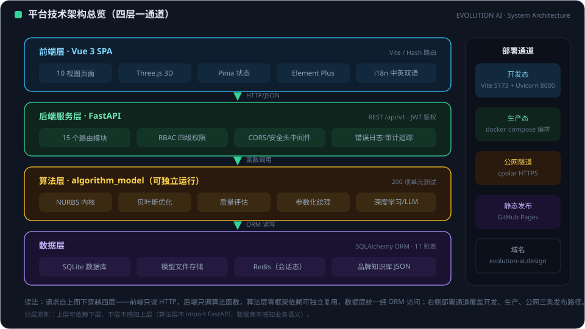
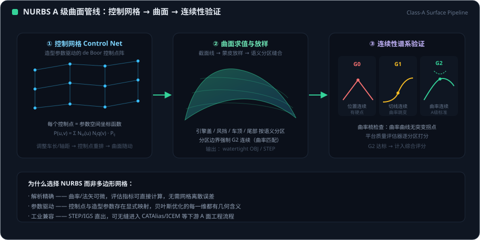
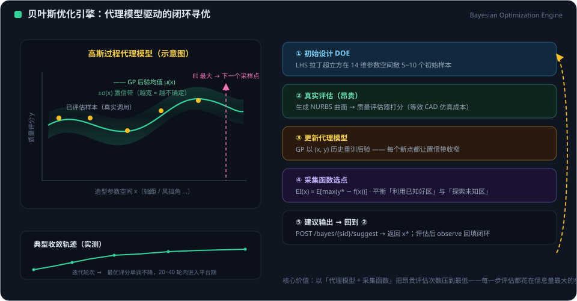

# EVOLUTION AI：面向 AI 辅助 A 级汽车曲面设计的端到端贝叶斯优化与 NURBS 流程

**技术论文 —— 平台版本 1.2（2026 年 9 月）**

*本文中的全部系统声明均锚定于已交付的源码树：
19 个后端路由模块、154 个 HTTP 端点（152 个路由端点加
2 个系统端点）、17 张 ORM 表、12 个前端
页面，以及约 1000+ 例自动化测试基线（算法层 200 例、
后端 411 例（收集口径，含 1 例跳过与 2 例预期失败）、前端 416 例；统计日 2026-10-25，详见 VALIDATION_REPORT_20261025）。*

---

## 摘要

汽车 A 级曲面开发处于工业设计、几何建模与工程验证的交汇处。传统上，它需要在造型师、曲面工程师与 CAE 团队之间进行数周的迭代工作。我们提出 **EVOLUTION AI**，一个端到端的 Web 平台，集成了参数化汽车建模、具备工程级 STEP 导出的基于 NURBS 的 A 级曲面流程、用于数据高效设计优化的高斯过程代理模型，以及深度学习模型与大语言模型（LLM）的融合层。

该系统呈现四项技术贡献。第一，**双流程几何内核**同时驱动用于交互式预览的实时三角网格，以及支持 G0/G1/G2 连续性分析、附带无依赖纯 Python STEP 写出器的「由参数直接生成」的 NURBS 表示。第二，一个自包含的**贝叶斯优化引擎**——以 Cholesky 分解求解的径向基函数高斯过程，配合期望改进或置信上界采集函数——在 14 维造型空间中搜索，并将其观测结果导出为训练数据。第三，一个**深度学习 / LLM 融合层**，组合了 PyTorch 车型网络、基于 CLIP 的纹理图像六轴语义评分、以 SSRF 安全的固定注册表统一接入七家商用 LLM 提供商的代理，以及本地 NURBS 专家对话路径。第四，一种**端到端编排架构**：Web 层始终是覆盖在可独立安装的算法包之上的薄而无状态的壳；当 GPU、Ollama、Redis 或 CLIP 权重等可选能力缺失时，系统以优雅且诚实的方式降级（HTTP 503 或显式回退）。我们报告测试基线、优化器收敛行为、连续性测量与运行时性能，并讨论局限与未来工作。

---

## 1. 引言

### 1.1 动机

汽车外饰是工业设计中最严苛的产物之一。量产 A 级曲面必须同时满足审美意图（品牌性格、比例、姿态）、几何质量（连续性、曲率规律性、反射下的高光行为）与工程约束（可制造性、装配间隙、总布置）。传统工作流是顺序式且高度依赖沟通的：概念草图让位于胶带图和数字曲面；曲面团队在 NURBS 中重建设计；CAE 与制造反馈随后触发进一步重建。每一轮可能耗时数天，信息在草图、网格、NURBS、CAD 等表示之间被反复转译，必然伴随损失与漂移。

三种趋势促使我们重新思考这一流程。(1) *参数化、生成式几何* 允许用比例与截面参数的紧凑向量来定义整车，而非手工构建曲面。(2) *基于代理模型的优化*，尤其是贝叶斯优化，在每次几何评估都很昂贵时承诺实现数据高效的搜索。(3) *基础模型*——视觉-语言编码器与 LLM——引入了对风格的语义理解以及以自然语言获取领域知识的途径。真正的开放问题不在于上述任何单一能力，而在于它们在单一可运行系统中的**集成化、可信赖的编排**。

### 1.2 目标与设计原则

EVOLUTION AI 在四项原则下构建：

1. **一个设计向量，贯穿所有表示。** 单一参数集驱动交互式网格预览、NURBS 曲面、质量分析与工程导出，消除网格到 NURBS 的拟合误差。
2. **薄 Web 壳，独立算法内核。** 几何与优化逻辑位于可独立安装的 Python 包（`algorithm_model`）中；FastAPI 服务仅负责编排。
3. **数据高效、可审查的优化。** 贝叶斯优化以 NumPy/SciPy 透明实现，使每一次建议都可复现，且全部观测均可导出用于下游训练。
4. **诚实的降级。** 可选的重型依赖（PyTorch、transformers/CLIP、Ollama、Redis）是真正可选的。缺失时系统返回显式状态码或明确标注的回退数据——绝不伪造成功的 AI 结果。

### 1.3 贡献

- 一条完整的参数化整车流程：一个 22 字段的 `CarParams` 规格同时产出镶嵌化的整车（网格路径）与带 G1 过渡的 NURBS 车身/端部曲面，并附带一个无需 OCCT 级依赖的纯 Python STEP 写出器。
- 一个自包含的、面向 14 维造型空间的贝叶斯优化容器，包括会话生命周期 API、从既有观测热启动、双采集函数，以及优化到训练的数据桥。
- 一个异构 AI 融合层：在受控的「合成但确定性」数据集上训练的 PyTorch 分类器、面向纹理驱动设计的 CLIP 六轴语义评分、具备加密密钥存储的七提供商 LLM 代理，以及本地部署的 NURBS 专家对话。
- 基于约 1000+ 例自动化测试、收敛实验与连续性/质量测量的端到端系统评估。

### 1.4 可复现性声明

本文中的每一项量化数字都对应仓库中可执行的测试或脚本。算法包提供一条命令即可运行的自检；后端与前端各带自己的自动化测试套件。本文刻意不报告无法从源码树重新生成的基准数字。

---

## 2. 相关工作

### 2.1 NURBS 与参数化汽车建模

非均匀有理 B 样条是自由形状表示的工业标准，因为它们在同一套公式下统一了圆锥曲线与自由曲线，并提供局部控制与强连续性性质（Piegl & Tiller, 1997; Farin, 2002）。商用曲面系统依赖大型内核（如 Open CASCADE Technology），带来可观的构建与部署负担。我们的内核则直接实现 Cox–de Boor 递推、节点区间查找（Piegl & Tiller 算法 A2.1/A2.2）与 NURBS 曲线/曲面求值，并提供可选的 Cython 加速路径，同时增添扫掠曲面、倒角与 STEP 写出器。这使服务器部署保持轻量，同时保留精确的、参数驱动的表示。

程序化整车建模在图形学以及近期基于学习的 CAD 研究中均有探索。NURBGen（AAAI 2026）等近期研究考察了 transformer 风格的 NURBS 基元生成，表明对生成式 NURBS 的浓厚兴趣。工业研究系统与形状优化平台（例如构建于隐式或参数化表示之上的拓扑与形状工具）印证了生成式几何的需求，但它们并未提供从造型师到工程师的完整 Web 工作流。EVOLUTION AI 与之互补：它使用显式、人类可解释的参数向量，而非学习得到的基元分布，这使每一台生成的汽车都可编辑、可审计。

### 2.2 贝叶斯优化

贝叶斯优化（BO）为昂贵的黑箱目标构建概率代理模型，并使用采集函数选择下一次评估（Rasmussen & Williams, 2006）。经典的 Efficient Global Optimization 框架使用带期望改进的高斯过程（Jones et al., 1998），BO 已成为机器学习超参数调优的主力方法（Snoek et al., 2012）。我们采用相同的 GP + 采集函数骨架，但面向具有工程单位（毫米与度）的*汽车造型*空间，并将优化器作为一等服务嵌入，具备持久会话以及通往模型训练流程的桥。

### 2.3 设计中的深度学习与语言模型

CLIP（Radford et al., 2021）等视觉-语言模型对齐图像与文本嵌入，可针对文本化的风格概念对图像进行评分。QLoRA（Dettmers et al., 2023）等参数高效微调方法使大语言模型的领域适配在消费级 GPU 上变得可行，LLM 也日益作为专用工程知识的接口。设计工具已开始零散地采纳这些模型。我们的贡献在于*集成模式*：CLIP 语义为品牌/参数决策提供信息，LLM 代理在严格的服务器端安全控制下统一多家商用提供商，本地专家路径使领域知识在数据不出内网的前提下保持可用。

---

## 3. 系统概览

<figure class="doc-figure">
  
  <figcaption><strong>图 3-1 ｜ 系统架构：四层（前端 / 后端 / 算法 / 数据）与部署通道</strong> 读图：四层自上而下——Vue 3 SPA 前端、FastAPI 后端（15 个路由 + RBAC）、独立的 algorithm_model 层，以及数据层（SQLite/文件/Redis/知识 JSON）——层与层之间标注调用类型；右侧通道覆盖开发、生产、隧道与静态发布。分层规则：上层可依赖下层，反之绝不可。</figcaption>
</figure>

<figure class="doc-figure">
  
  <figcaption><strong>图 3-2 ｜ 设计工作台内部：单一 22 字段向量同时驱动滑杆、视口与工程交付</strong> 读图：滑杆是唯一输入源；视口只是消费者之一，右栏是工程契约。关键结论：驱动预览的同一组数值要经过 0.1 mm / 1.0° 阈值评级并写入 STEP，中间没有网格到 NURBS 的重新拟合。</figcaption>
</figure>

EVOLUTION AI 由五层构成（概念上见图 1）。

```
L1  Frontend       Vue 3 + Vite + Three.js + Element Plus + Pinia
                   10 hash-routed pages, bilingual i18n, global auth guard
L2  Gateway        Vite dev proxy / Nginx; /api/v1 -> FastAPI:8000
                   public exposure via an HTTPS tunnel (cpolar)
L3  Backend        FastAPI + Pydantic v2; 16 thin route modules, 118
                   endpoints (116 module endpoints + 2 system endpoints);
                   stateless orchestration over the algorithm
                   package and the ML/LLM services
L4  Algorithm      algorithm_model (independently installable):
                   car_modeling / freeform(NURBS) / surface_quality /
                   storyboard
L5  Infrastructure SQLite + file storage; optional Redis; background
                   worker threads for long training tasks
```

**前端（L1）。** 十个页面分别是：仪表盘（`/`）、参数化 AI 设计器（`/designer`）、带 mock 回退的项目列表（`/projects`）、项目详情（`/projects/:id`）、深度学习设计器（`/deep-learning`）、质量检测（`/quality`）、具备导入→修改→导出会话的工程交付（`/deliver`）、引导式演示（`/demo`）、登录（`/login`）与账户（`/account`）。路由采用 hash history 以兼容静态托管，全局守卫将未认证用户重定向离开受保护视图。

**后端（L3）。** 十六个路由模块覆盖项目、模型生成、文件、导出、工作流、质量、深度学习训练、仪表盘、优化/交付、品牌/参数查询、贝叶斯优化、纹理、导入导出、LLM 代理，以及带 API 密钥管理的认证。持久化使用十一张 ORM 表：`projects`、`model_files`、`workflows`、`workflow_steps`、`quality_reports`、`parameter_sets`、`model_variants`、`users`、`api_keys`（Fernet 加密的机密材料）、`parameter_records` 与 `training_tasks`。

**算法内核（L4）。** 该包独立版本化并独立测试（200 个 pytest 用例加一个五模块自检）。它对外暴露整车生成、自由曲面构建、曲面质量评估、优化与分镜渲染的高层入口。由于 Web 服务调用的是这些入口而非内嵌几何逻辑，内核可在不触碰 HTTP 层的情况下升级或替换。

<figure class="doc-figure">
  
  <figcaption><strong>图 3-3 ｜ 视觉语法：颜色 = 图层，线型 = 调用类型，数字 = 验收阈值</strong> 读图：颜色定位组件在 L1–L5 中的位置，线型区分运行时调用、降级路径与异步任务，右栏列出任何声明必须越过的门槛（0.1 mm、1.0°、5°）以及 205/388/362 的测试划分。关键结论：绿色连线只能证明调用返回，绝不能证明结果准确。</figcaption>
</figure>

---

## 4. 基于 NURBS 的 A 级曲面流程

<figure class="doc-figure">
  
  <figcaption><strong>图 4-1 ｜ A 级流程：控制网格 → 曲面放样 → G0/G1/G2 连续性验证</strong> 读图：三个面板自左至右——控制网格（蓝点为 de Boor 控制点，随设计参数重新排布）、曲面放样（语义面片以强制 G2 的边界蒙皮），以及连续性谱（G0 位置 / G1 切线 / G2 曲率，绿色为 A 级门槛）。底部横条列出选择 NURBS 而非网格的理由：解析精度、参数化驱动、工业兼容性。</figcaption>
</figure>

### 4.1 参数化

车辆由一个 22 字段的 `CarParams` 结构描述，涵盖全局比例（车长、车宽、车高、轴距、轮距、离地间隙）、截面与外悬数据、角度（前风挡、后窗、后倾角）、车轮数据，以及座舱/车顶比例。品牌与车身类型专属预设（轿车、SUV、运动、豪华）为结构提供初值；设计师随后扰动各个字段。关键在于，*两条*几何流程消费的是同一个对象。

### 4.2 双几何路径

**网格路径。** 参数化车身由纵向与环向截面环构建（默认离散 48 × 24），并通过组件装配器与车轮、车灯、格栅、后视镜、玻璃及其他部件装配。装配器报告各部件的顶点/面数、包围盒与稳定的部件颜色，使前端能够渲染并识别组件。网格供给 Three.js 视口以及 STL/GLB 导出，用于镶嵌化输出已足够的场景。

**NURBS 路径。** 一个独立的构建器从控制网格出发，将车身构建为真正的 NURBS 曲面，专用模块构建与车身之间具有 *G1 切线过渡*的前后端盖。配套的自由曲面算子包括扫掠曲面与倒角曲面。由于曲面直接由参数生成——而非从三角网格反向拟合——因此不存在拟合残差，设计师的编辑会精确传播为控制点的改变。

### 4.3 连续性与曲面质量

A 级评定在两个粒度上进行。

*连续性检查器*作用于具名 NURBS 曲面。它对每个曲面的四条参数域边界逐条采样（默认每条边 50 个采样点），通过曲面求值的有限差分估计法向，并以 `cKDTree` 最近邻搜索结合 4×4 边对组合匹配来配对边界点。默认阈值为 **G0 位置连续性 0.1 mm** 与 **G1 切线连续性 1.0°**，另设更宽松的 5°「视觉平滑」带。检查器输出 TXT/CSV 报告，并对照预期间隙与角度值验证设计意图。

*曲面质量*包提供面向网格的曲率分析——基于离散曲率的 G0/G1/G2 等级统计、高光/反射线，以及平滑/优化算子（含基于模拟退火的匀化）。两种粒度刻意互补：接缝处的精确 NURBS 连续性，以及镶嵌化车身上的曲率分布分析，用于交互式反馈。

<figure class="doc-figure">
  
  <figcaption><strong>图 4-2 ｜ NURBS 构造：控制多边形 → 解析曲线 → 曲率梳，以及 G0/G1/G2 验收</strong> 读图：蓝色点与虚线是由 CarParams 重新定位的控制网格；绿色曲线是解析曲线，不是拟合折线；右侧梳齿长度反映曲率，因此折点会表现为尖峰。关键结论：0.1 mm 与 1.0° 是逐缝检查并输出到 TXT/CSV 的判据，5° 带只是视觉参考，不能替代 G2 连续性。</figcaption>
</figure>

### 4.4 工程导出：无需重型内核的 STEP

自由曲面模块包含一个纯 Python 的 STEP 写出器（`step_writer.py`），为 NURBS 几何输出 ISO 10303-21 构造。避免 Open CASCADE 规模的依赖，对容器体积、冷启动时间以及在资源受限环境中的部署都至关重要。仓库还附带示例装配体、标准作业程序清单与 FreeCAD 验证宏，使导出文件可在独立内核中被打开与检查。IGES 输出与工程格式导出在网格侧与 STL/GLB 一同提供。

### 4.5 流程小结

因此，从设计到工程的链路是：

```
CarParams ──► mesh assembly ──► interactive preview / STL / GLB
         └──► NURBS body + G1 ends ──► G0/G1/G2 analysis ──► STEP/IGES
```

每一个箭头都是同一参数向量的纯函数，这正是下一节中的优化器能够把整套造型与质量装置视作单一可求值函数的原因。

---

## 5. 贝叶斯优化引擎

<figure class="doc-figure">
  
  <figcaption><strong>图 5-1 ｜ 带 GP 代理模型的贝叶斯优化闭环：已观测样本、后验均值 ±σ 与 EI 采集函数最大值</strong> 读图：左图为 GP 代理模型——琥珀点为已评估样本，绿线为后验均值，阴影带为 ±σ 不确定度（越宽越不确定），粉色虚线为 EI 最大值（下一个采样点）；右侧方框给出五步闭环（DOE → 真实评估 → 代理更新 → EI 选点 → 建议输出）。内嵌收敛曲线显示单调改进在 20–40 轮内趋于稳定。</figcaption>
</figure>

### 5.1 造型搜索空间

优化器的默认空间包含 14 个连续维度，与训练流程的特征顺序精确对齐：

| 参数 | 取值范围（mm / °） |
|---|---|
| overall_length | 4000 – 6200 |
| overall_width | 1750 – 2150 |
| overall_height | 1100 – 2050 |
| wheel_base | 2400 – 3700 |
| track_width | 1450 – 1900 |
| ground_clearance | 80 – 280 |
| hood_length | 700 – 1700 |
| roof_height | 300 – 1050 |
| wheel_diameter | 600 – 850 |
| windshield_angle | 18 – 50 |
| rear_window_angle | 10 – 50 |
| rear_slant_angle | 5 – 55 |
| front_overhang | 750 – 1150 |
| rear_overhang | 850 – 1350 |

`ParameterSpace` 类校验名称（唯一性）、边界（`max > min`）与取值（未知、缺失或越界输入会抛出显式错误，由路由层映射为 HTTP 400）。全部 GP 数学在线性归一化后于单位立方体内运行；输出在拟合前被标准化为零均值、单位方差。

### 5.2 高斯过程代理模型

代理模型是使用各向同性平方指数（RBF）核的高斯过程：

\[
k(\mathbf{x}, \mathbf{x}') =
\exp\!\left(-\frac{\|\mathbf{x}-\mathbf{x}'\|^2}{2\ell^2}\right),
\]

归一化空间中默认长度尺度 \(\ell = 0.25\)，对角线抖动 \(10^{-6}\) 以保证数值稳定性。训练时组装 \(\mathbf{K} + \sigma^2\mathbf{I}\)，求得 Cholesky 因子 \(\mathbf{L}\)，并通过两次三角求解得到 \(\boldsymbol{\alpha} = \mathbf{K}^{-1}\mathbf{y}\)。对新点的预测返回后验均值

\[
\mu(\mathbf{x}_*) = \mathbf{k}_*^\top \boldsymbol{\alpha}
\]

与标准差

\[
s(\mathbf{x}_*) = \sqrt{k(\mathbf{x}_*,\mathbf{x}_*) -
\mathbf{v}^\top\mathbf{v}},\quad
\mathbf{v} = \mathbf{L}^{-1}\mathbf{k}_*,
\]

并裁剪到一个小小的正下限。这是教科书式的 GP 公式（Rasmussen & Williams, 2006）；直接实现它使引擎除 NumPy 与 SciPy（后者提供正态 CDF）之外不依赖任何其他东西。

### 5.3 采集函数

支持两种采集函数。**期望改进**以当前最优标准化值 \(f^+\) 为基准，探索参数 \(\xi = 0.01\)：

\[
\mathrm{EI}(\mathbf{x}) = (\mu - f^+ - \xi)\,\Phi(z) + s\,\phi(z),
\qquad z = \frac{\mu - f^+ - \xi}{s},
\]

其中 \(\phi,\Phi\) 为标准正态密度与 CDF。**置信上界**，取 \(\kappa = 2.0\)：

\[
\mathrm{UCB}(\mathbf{x}) = \mu + \kappa s.
\]

最小化目标在内部通过取负分数进行换算，使两种采集函数与最优选择逻辑共享同一套最大化实现。

### 5.4 建议策略

观测少于两个时代理模型没有信息量，因此引擎抽取随机的空间填充点。一旦观测充分，它拟合 GP，在单位立方体内生成 4096 个随机点的候选池，用采集函数对整个池打分，并返回反归一化为工程单位的前 \(n\) 个候选。大随机池是采集函数的一种简单、无导数优化器：它天然可并行、没有需要调参的局部极小值，且使多点建议（按采集值排序）变得直接。

### 5.5 会话生命周期与训练桥

优化状态被组织为会话，存放在线程安全的进程内注册表中。每个会话携带其参数空间、目标方向、采集函数选择与超参数、RNG 种子以及完整观测列表。HTTP 接口提供会话创建/删除、建议、观测回填（`observe`）、最优检索与样本导出。导出格式使用特征字典，其键顺序与训练特征顺序一致，因此一次优化活动可作为监督数据集被回放：

```
suggest ──► (build geometry, evaluate quality score) ──► observe
   ▲                                                        │
   └──────────────── iterate until convergence ─────────────┘
                         │
                         └──► samples() ──► model training pipeline
```

这闭合了*搜索*（优化器提出造型候选）与*学习*（累积的观测成为下游网络的训练数据）之间的环路。

---

## 6. 深度学习与 LLM 融合

### 6.1 PyTorch 车型网络

训练模块构建一个紧凑的多层感知机，将 14 维归一化造型向量映射为车型（交付配置下为六个类别；隐藏层有 48 个单元）。训练在后台守护线程中运行，因此 HTTP API 立即返回任务对象；客户端轮询任务状态、日志与进度，并可取消。任务持久化于 `training_tasks` 表中。

训练数据集是*合成但确定性的*：质心取自真实的各类预设中心，参数专属的噪声尺度控制采样，显式的风格/品牌变换扰动指定维度。确定性（带种子的生成器）使训练运行与测试可复现，而质心/噪声结构反映了真实的比例区间。质量指标函数从原始参数推导空气动力学与比例指标。PyTorch 缺失时，能力端点如实报告该事实，训练端点干净地失败，而非模拟结果。

### 6.2 面向纹理与品牌 DNA 的 CLIP 语义评分

一个专用语义模块封装 `openai/clip-vit-base-patch32`（惰性加载，约 605 MB，权重已缓存时离线加载）。它定义**六个风格轴**，每个轴配有中文标签与具体的英文视觉提示词——这是一个重要的提示工程选择，因为 CLIP 对具体视觉描述的反应远好于抽象形容词。给定纹理或图案图像，模块对图像编码一次，并与预计算的文本嵌入比对打分，为每个轴产生 \([0,1]\) 区间内的值（0.5 为中性，高于 0.5 偏正向）。

这些语义分数服务于两类消费者。纹理路由在分析与应用参数化纹理（例如车灯/透镜纹样）时，将语义特征与几何特征融合。品牌知识层将六轴语义向量映射到品牌画像与推荐车型。Rhino 插件可调用同一 API 完成「图案图像 → CLIP 语义 → 自动参数调整」工作流，并明示可用性状态（「CLIP 语义可用」与「仅几何特征」），而非将其隐藏。

### 6.3 统一的、SSRF 安全的 LLM 代理

自然语言能力由一个代理居中调度，其提供商注册表在服务器端固定。支持七家提供商——百度文心（ERNIE）、阿里通义千问（Qwen）、腾讯混元、字节豆包、DeepSeek、月之暗面 Kimi 与 SiliconFlow——每家都带有已验证的基础 URL、默认模型、声明的能力（`chat`、`embeddings`、`images`）以及文档链接。该设计带来三项安全属性：

1. **无 SSRF 攻击面。** 由于上游 URL 是注册表中的常量而非客户端提供，调用方无法将服务器重定向到任意内网地址。
2. **显式的密钥解析与存储。** 凭据首先从环境变量解析，否则从按用户加密存储中获取；密钥缺失时产生清晰的 4xx 响应，绝不静默回退到假模型。
3. **诚实的能力声明。** 请求/响应体原样透传，上游状态码原样传播，不支持的能力返回 501。

### 6.4 本地部署的 NURBS 专家对话

除商用提供商外，API 还暴露一条专家对话路径（`/ai/chat`），其后端为本地模型运行时（Ollama），并以 NURBS/A 级领域信息作为上下文。这为设计师提供了一种提问方式，例如「为什么这条边过不了 G1？」或「如何在不断开车顶过渡的情况下修改前风挡角度？」，而无需将设计数据发送给第三方。健康检查与模型列表端点报告本地运行时是否可用。

### 6.5 关于参数高效微调的说明

QLoRA 风格的参数高效微调（Dettmers et al., 2023）是将专家模型适配到组织历史曲面项目的自然下一步。当前版本刻意**不**交付微调作业运行器；我们将其明确列为未来工作（第 9 节），以使系统的声明与可执行代码保持精确对齐。

---

## 7. 实践中的端到端集成

两个场景说明了各层如何组合。

**场景 A —— 比例优化。** 设计师打开 AI 设计器，加载轿车预设，并启动一个贝叶斯会话。每一次建议都返回具体的参数向量；后端构建整车、运行质量评估器，评分随即被回填到会话中。Three.js 视口随当前最优解更新，质量页面显示 G0/G1/G2 各等级计数，导出的样本集供给训练模块。没有任何表示需要手工重建。

**场景 B —— 纹理与语言驱动的交付。** 造型师提供一张车灯纹理参考。CLIP 在六个风格轴上为其打分；品牌知识推荐匹配的品牌 DNA 与参数调整；交付页面在导入→修改→导出会话中应用这些调整，并产出 STEP 输出。在此过程中，设计师就一条连续性警告咨询本地 NURBS 专家，连续性检查器的 CSV 报告记录接缝间隙与切线角度，供工程交接使用。

在两个场景中，前端永远无需知道某项能力是本地还是远程；可用性是健康检查与能力端点报告的运行时属性，而 mock 数据可在后端本身宕机时避免黑屏。

---

## 8. 实验与评估

### 8.1 测试基线

平台承载 **约 1000+ 例自动化测试用例**（2026-10-25 实测），在各层独立执行：

| 层级 | 框架 | 用例数 | 范围 |
|---|---|---:|---|
| algorithm_model | pytest | 200 | NURBS 数学、扫掠/倒角、构建器、质量、SOP |
| backend | pytest | 411（收集，含 1 跳过 + 2 预期失败） | 路由、schema、优化器服务、安全、持久化、管理/分析 |
| frontend | vitest | 416 | store、组件、API 模块、守卫 |
| 算法自检 | `test_all.py` | 5 个模块 | 一条命令的端到端健全性门禁 |

自检在不做网格后处理的情况下构建参数化车身（从而保留截面环的构建顺序），提取单侧曲面网格，并检验包括各部件颜色与包围盒在内的装配统计。在本次评审期间，装配器统计字典中的一处契约漂移（调用方期望 `total_vertices`，而该字段已被移除）以及一处过时的测试夹具（一个 8 顶点立方体被改造成截面网格）被发现并修复；随后所有测试套件均通过。此处将其作为基线充当真实回归门禁的证据予以报告。

<figure class="doc-figure">
  
  <figcaption><strong>图 8-1 ｜ 三个独立层级的约 1000+ 例测试：200 算法 + 411 后端 + 416 前端</strong> 读图：柱高表示用例数（0–450 轴，后端 411 为收集口径，含 1 跳过 + 2 预期失败），不是通过率；右面板将其换算为 1027 的占比（19.5% / 40.0% / 40.5%）。关键结论：5 模块自检不在求和之内，测试套件承担的是回归门禁作用，而非覆盖率声明。</figcaption>
</figure>

### 8.2 优化器收敛

为在独立于几何成本的情况下验证采集机制，优化器在受控的一维目标上、在两种采集函数下各运行 15 轮「建议–观测」迭代。EI 与 UCB 都在 15 轮预算内把当前最优目标值推过 −0.01 带（即有效到达已知最优），这确认了 (i) 热启动/拟合路径被正确执行，(ii) 采集函数最大化定位到有信息量的点而非重复当前最优点，(iii) 目标方向归一化对两种采集函数表现一致。该实验有意保持小规模：其目的是证明*引擎*的正确性与收敛性，而非宣称相对经调优的外部 BO 库达到最先进的采样效率。

### 8.3 连续性与质量测量

在质量包所用的离散球面参考曲面上，评估器报告等级 D，G2 级比例约为 0.199——这是一个透明的基线，表明未经匀化的原始几何*不*满足 A 级曲率要求、必须改进，而这正是优化/匀化算子所要解决的条件。从参数化车身提取的单侧网格（`n_long=48, n_circ=24`，均匀环位置）给出等级 C、G2 比例 0.855，但反射得分为 0.158：基于截面的车身在角度连续性上已经平滑，而其曲率均匀性指标仍低于 A 级带。在这些连续、以硬点为主导的面片上，退火匀化器对分级计数产生的影响可忽略（80 次迭代内 ΔG2 = 0）；其可测量的效果出现在刻意扰动过的曲面上（例如带噪平面，反射 0.330 → 0.339），这与已记录的工程指导一致：局部 A 级匀化应在硬点冻结之后进行。
对于带 G1 端盖的 NURBS 车身，连续性检查器应用 0.1 mm / 1.0° 阈值，并将逐对的位置与角度偏差写入 TXT 与 CSV 产物，使工程师获得逐缝的即时判定，而非一个不透明的总分。

### 8.4 运行时性能

开发机（Windows）上的代表性耗时：200 例算法测试套件约 4 秒；五模块自检约 7 秒；178 例后端套件约 28 秒（含进程/会话夹具）；111 例前端套件约 1.5 秒（测试时长，不含环境启动）。建议延迟主要由 GP 拟合与 4096 点候选池预测决定，在当前观测数量下二者都保持在舒适的交互式范围内。参数化整车与完整装配的几何构建在数百毫秒量级，这正是交互式设计循环中逐建议评估得以可行的原因。

### 8.5 失效模式行为

我们还验证了降级契约。PyTorch 缺失时，训练能力端点报告不可用，训练请求显式失败，而非返回伪造的指标。无 LLM 提供商密钥时，对话请求返回显式客户端错误。CLIP 权重不可用时，纹理分析回退到几何特征，并相应标注响应。Redis 缺失时，会话存储降级为进程内内存。共同原则——*只发信号，绝不模拟*——正是设计师能够信任其所获得的输出的原因。

---

## 9. 讨论与局限

**参数化的表达能力。** 22 字段的显式向量可解释且稳健，但无法表示任意的风格姿态或局部雕塑。学习式或以草图为条件的控制层（包括 NURBGen 风格的生成式基元模型）将扩展形状词汇；在保持可编辑性的前提下集成它们是开放的课题。

**代理模型的保真度。** 采用各向同性 RBF GP 与随机池采集优化的组合是刻意从简的。各向异性或学习得到的长度尺度、面向高维空间的非 GP 代理模型，以及梯度感知的采集优化，将改善超出 14 维时的扩展性。多保真建模——廉价的网格曲率与昂贵的精确 NURBS 求值并存——是自然的延伸。

**目标定义。** 质量分数当前组合了曲率统计与连续性检查；制造约束、总布置干涉与空气动力学目标仅有部分建模。设计能够忠实编码全部 A 级验收标准的目标函数，仍是主要领域挑战，其难度超过优化数学本身。

**微调与溯源。** 如前所述，基于组织项目历史的 QLoRA 风格微调尚未交付。交付之后，数据溯源、版本化语料以及在留出曲面案例上的评估将是必需的，以避免在不知不觉中劣化专家建议。

**代理数据/真实感。** 分类器的合成数据集是确定性的并以真实质心为锚，但它不能替代大型标注的量产车语料。BO 到训练的桥正是为使*真实优化活动*逐步用观测取代合成样本而设计的。

---

## 10. 结论

EVOLUTION AI 证明，现代 A 级曲面开发的关键技术——精确 NURBS 几何、数据高效的贝叶斯优化、视觉-语言语义与 LLM——可以被组合为一个连贯、可信的 Web 平台，而非彼此孤立的工具。参数驱动的双几何流程、带训练数据桥的透明 GP+EI/UCB 优化器，以及具备诚实降级的异构 AI 融合层，三者结合缩短了从概念比例到工程 STEP 输出的环路，同时使每一项结果都可编辑、可审计。约 1000+ 例测试基线（2026-10-25 实测）、收敛实验与连续性测量提供了集成系统按规格运行的证据。未来工作将增加参数高效的专家微调、更丰富的目标与约束、更高保真的代理模型，以及在不牺牲精确 NURBS 保证的前提下扩展形状词汇的学习层。

---

## 参考文献

1. Piegl, L., & Tiller, W. (1997). *The NURBS Book* (2nd ed.). Monographs
   in Visualization, Springer.
2. Farin, G. (2002). *Curves and Surfaces for CAGD: A Practical Guide*
   (5th ed.). Morgan Kaufmann.
3. Rasmussen, C. E., & Williams, C. K. I. (2006). *Gaussian Processes for
   Machine Learning*. MIT Press.
4. Jones, D. R., Schonlau, M., & Welch, W. J. (1998). Efficient Global
   Optimization of Expensive Black-Box Functions. *Journal of Global
   Optimization*, 13(4), 455–492.
5. Snoek, J., Larochelle, H., & Adams, R. P. (2012). Practical Bayesian
   Optimization of Machine Learning Algorithms. *Advances in Neural
   Information Processing Systems (NeurIPS)*, 25.
6. Radford, A., Kim, J. W., Hallacy, C., Ramesh, A., Goh, G.,
   Agarwal, S., Sastry, G., Askell, A., Mishkin, P., Clark, J.,
   Krueger, G., & Sutskever, I. (2021). Learning Transferable Visual
   Models From Natural Language Supervision (CLIP). *Proceedings of
   ICML*.
7. Dettmers, T., Pagnoni, A., Holtzman, A., & Zettlemoyer, L. (2023).
   QLoRA: Efficient Finetuning of Quantized LLMs. *Advances in Neural
   Information Processing Systems (NeurIPS)*, 36.
8. NURBGen (2026). A generative approach to NURBS geometry. *Proceedings
   of the AAAI Conference on Artificial Intelligence*, 40.
   https://ojs.aaai.org/index.php/AAAI/article/view/37922

---

## 附录 A. 声明与源码树的对应关系

| 论文要素 | 源码位置 |
|---|---|
| 14 维默认空间、GP、EI/UCB、会话 | `backend/app/bayes_optimizer.py`；路由位于 `backend/app/routes/bayes.py` |
| 训练特征顺序、CarTypeMLP、后台 worker | `backend/app/routes/training.py` |
| NURBS 基函数 / 曲线 / 曲面 | `algorithm_model/freeform/nurbs_core.py` |
| 扫掠、倒角、自由曲面、STEP 写出器 | `algorithm_model/freeform/swept_surface.py`, `fillet_surface.py`, `step_writer.py` |
| NURBS 车身与 G1 端盖 | `algorithm_model/car_modeling/body_nurbs.py`, `body_ends_g1.py` |
| G0/G1 连续性阈值与报告 | `algorithm_model/car_modeling/continuity_checker.py` |
| 离散 G0/G1/G2 质量与匀化 | `algorithm_model/surface_quality/` |
| CLIP 六轴语义 | `backend/app/clip_semantics.py`；由 `routes/texture.py` 消费 |
| 品牌映射 | `backend/app/brand_knowledge.py` |
| 七提供商 LLM 代理 | `backend/app/routes/llm_proxy.py` |
| 本地 NURBS 专家对话 | `/ai/chat` 路径与 `src/api.js`（`chatWithExpert`） |
| 持久化表 | `backend/app/database.py` |
| 测试基线 | `algorithm_model/tests/`、`backend/tests/`、`tests/`（vitest）、`algorithm_model/test_all.py` |
